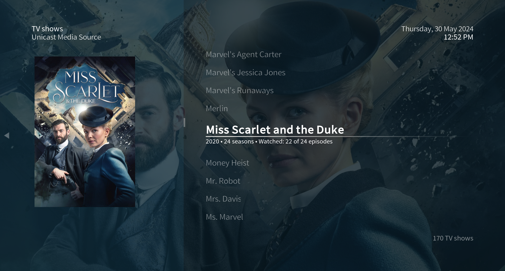
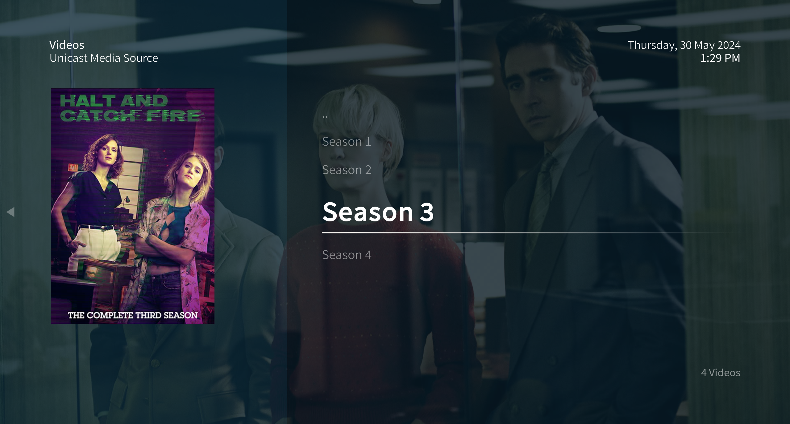
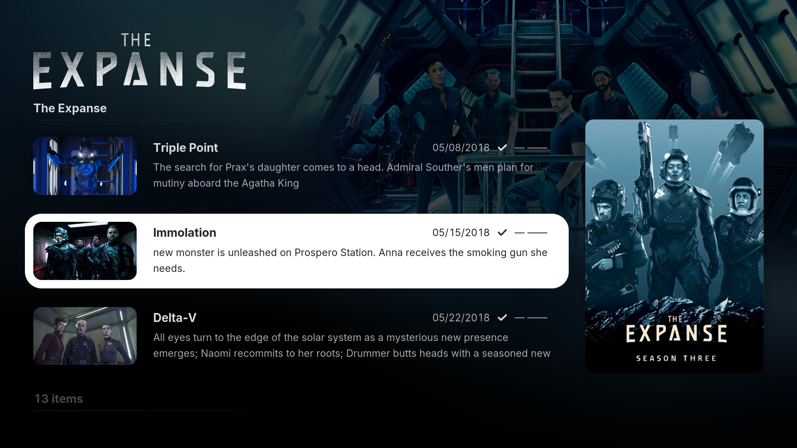
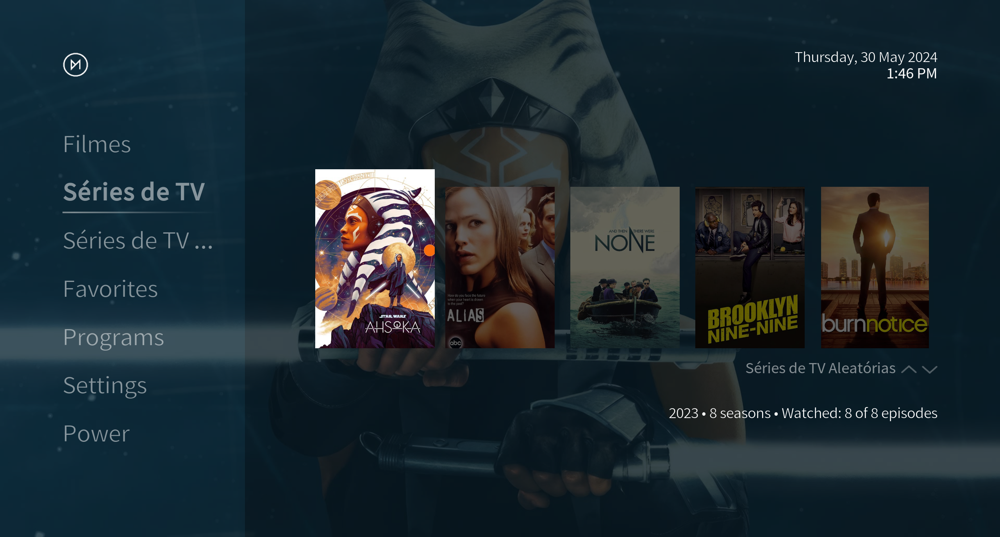

# plugin.video.unicast

A Kodi add-on to browse and play the media library of a [Unicast](https://github.com/pedromsilvapt/unicast) server from inside Kodi.

## Screenshots

<table>
  <tr>
    <td></td>
    <td></td>
    <td></td>
  </tr>
  <tr>
    <td></td>
    <td></td>
    <td></td>
  </tr>
</table>

The screenshots use the [OSMC](https://osmc.tv/) skin.
